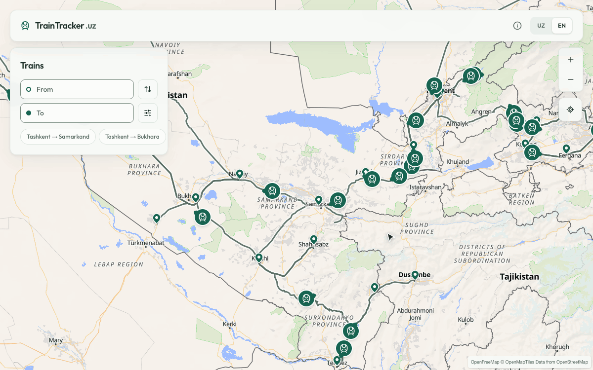

# TrainTracker.uz

Uzbekistan train map and timetable (O‘zbekiston poyezdlari xaritasi va jadvali). Built with Next.js, MapLibre and OpenFreeMap vector tiles.

Live: [traintracker-beta.vercel.app](https://traintracker-beta.vercel.app)



## Running locally

You need [Bun](https://bun.sh) and Node.js 22 or newer (the tests use Node's built-in test runner).

```bash
bun install
bun dev
```

`bun run build` makes a production build, `bun run lint` runs ESLint and `bun run test` runs the timetable tests in `tests/`. Note it's `bun run test`, not `bun test`: the second one starts Bun's own test runner and skips the script.

## How train positions work

Trains aren't tracked by GPS. A train's position is worked out from the timetable:

```
progress = (now - left the last stop) / time to the next stop
```

Stops along the way are taken into account, delays are not. A late train shows up where it should be, not where it actually is.

## Data

| What | Source |
| --- | --- |
| Timetable and fares | [eticket.railway.uz](https://eticket.railway.uz/) |
| Electric trains | [ticket.elektropoyezd.uz](https://ticket.elektropoyezd.uz/) |
| Intermediate stops | [Yandex Rasp](https://rasp.yandex.ru/) |
| Stations and rail lines | [OpenStreetMap](https://www.openstreetmap.org/copyright) contributors (ODbL) |
| Map tiles | [OpenFreeMap](https://openfreemap.org) |

TrainTracker.uz is an independent project and is not affiliated with Uzbekistan Railways (O‘zbekiston temir yo‘llari).

## Languages and URLs

Each language has its own crawlable URL: Uzbek (default) at the root, English under `/en`.

| Page | Uzbek | English |
| --- | --- | --- |
| Map | `/` | `/en` |
| About | `/about` | `/en/about` |
| Privacy policy | `/privacy` | `/en/privacy` |
| Terms of use | `/terms` | `/en/terms` |
| All routes | `/trains` | `/en/trains` |
| Route timetable | `/trains/<from>/<to>` | `/en/trains/<from>/<to>` |
| Map with a route filled in | `/?from=<from>&to=<to>` | `/en?from=<from>&to=<to>` |

The map reads `from` and `to` (station slugs) once and then removes them from the address bar, so a refresh starts clean. The share button in the route results builds this link.

`proxy.ts` rewrites the root to `/uz` internally and redirects a stray `/uz` URL back. A returning visitor who chose English (cookie `traintracker-lang`) is redirected to `/en`; crawlers carry no cookie and always get the default URLs.

## SEO

- Per-page `title`, `description`, canonical, `hreflang` (`uz`, `en`, `x-default`), Open Graph and Twitter cards (`lib/seo.ts`, `pageMetadata`).
- JSON-LD: `WebSite`, `WebApplication`, `AboutPage`, `BreadcrumbList`, `ItemList` of `TrainTrip`.
- `/sitemap.xml` lists every page in both languages with alternates, `/robots.txt` points to it.
- Route pages (`lib/seo-routes.ts`) are generated for every pair of stations with at least 5 trains calling at both, from the timetable data.
- Share image and Apple icon are static files in `public/` (`og-image.png` 1200x630, `apple-touch-icon.png`).

Environment variables (all optional):

- `NEXT_PUBLIC_SITE_URL`: the public address, used for canonical URLs, the sitemap and social cards. Defaults to `https://traintracker-beta.vercel.app`; set it when the final domain is in place.
- `GOOGLE_SITE_VERIFICATION`, `YANDEX_SITE_VERIFICATION`: verification tokens for Search Console and Yandex Webmaster.

## License

The code is under the [MIT license](LICENSE). That doesn't extend to the third-party content in the repo:

- The station photos in `public/stations/` come from O‘zbekiston Temir Yo‘llari's site (ticket.elektropoyezd.uz). The other station photos are loaded from their original sites. Each photo's source is listed in `lib/station-info.ts`.
- The Afrosiyob photo in `public/trains/` is by Serguei Bolachenko, CC BY-SA 3.0 (see `lib/trains-info.ts`).
- Station and rail line data is © OpenStreetMap contributors, available under the ODbL.
